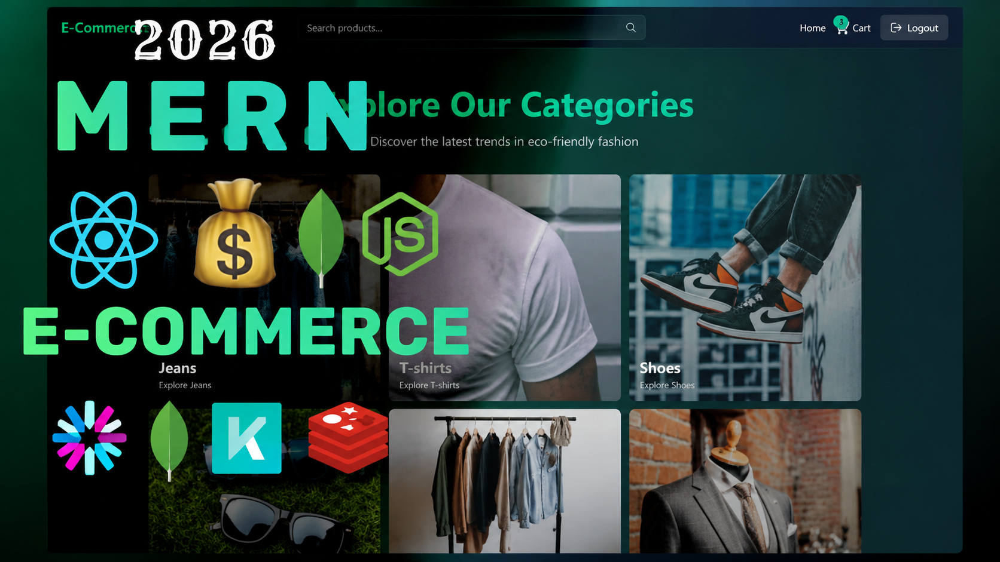
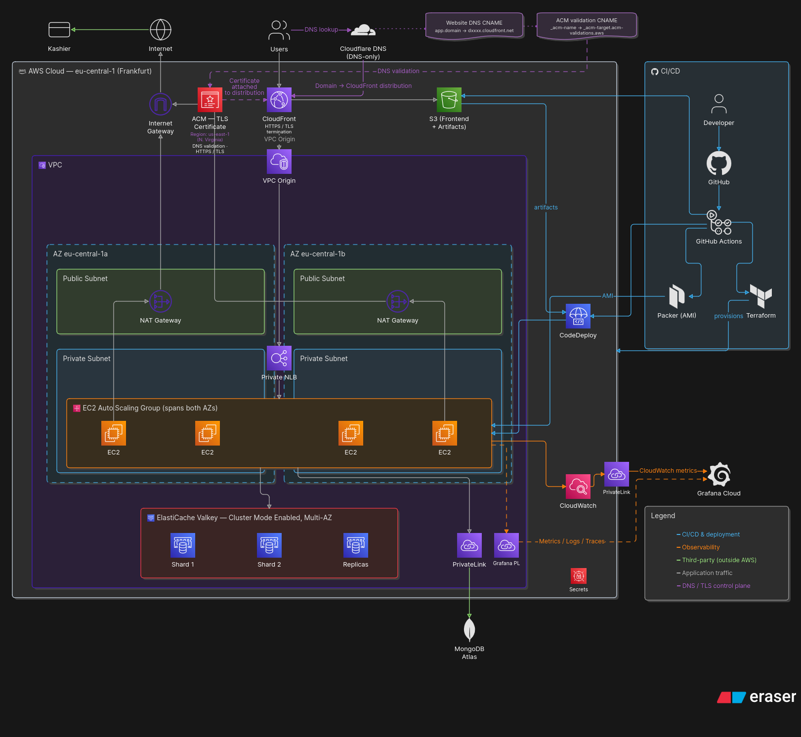
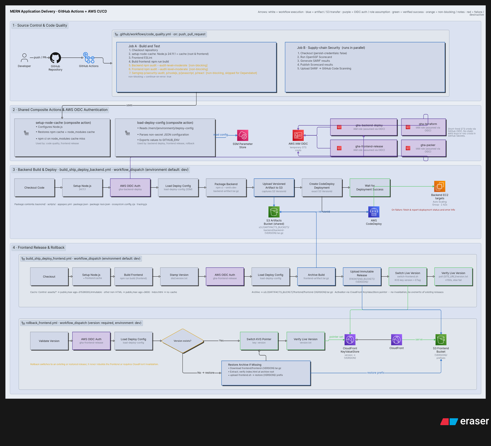
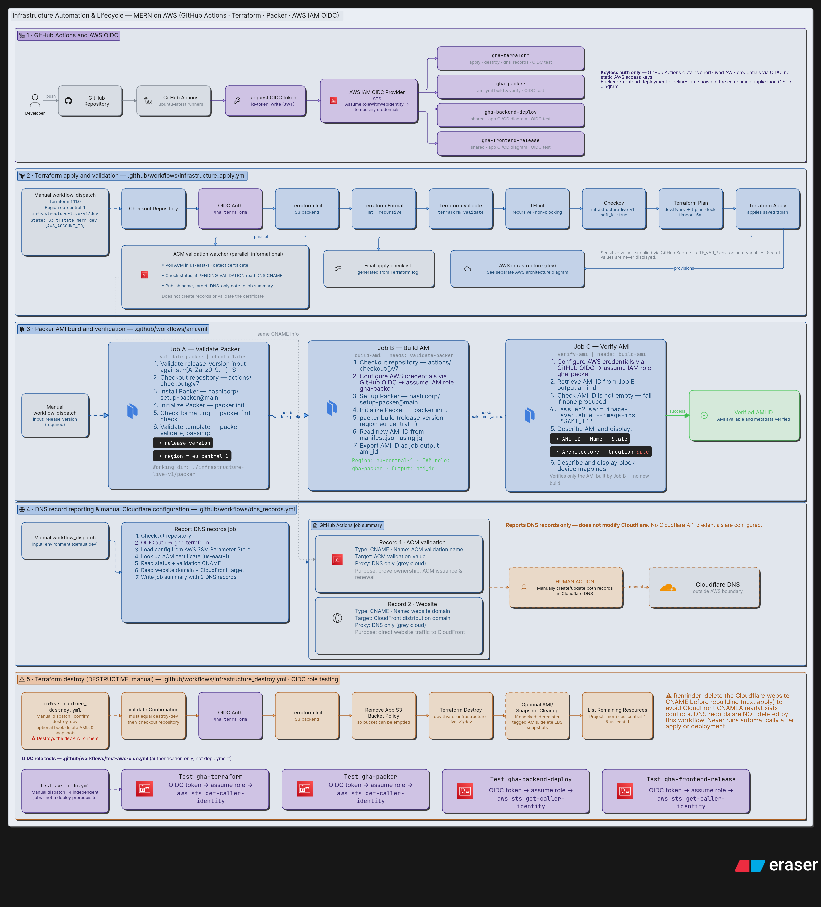

# MERN E-Commerce Platform

An e-commerce application with a React storefront, an Express/MongoDB backend, and AWS-based deployment infrastructure. It supports customer authentication, product management, carts, coupons, Kashier checkout, an admin dashboard, sales analytics, and Redis caching.

[Read the full project case study](https://abdullahsameh.tech/blog/mern)



## Technologies and features

- **Frontend:** React, Vite, Tailwind CSS, React Router, Zustand, Recharts
- **Backend:** Node.js, Express, MongoDB/Mongoose, Redis/Valkey, JWT authentication
- **Payments and storage:** Kashier payments, Amazon S3 product images, CloudFront delivery
- **Infrastructure:** Terraform, AWS VPC, EC2 Auto Scaling, Network Load Balancer, CloudFront, ACM, Secrets Manager, MongoDB Atlas PrivateLink
- **Observability:** Grafana Cloud, OpenTelemetry, Grafana Alloy
- **Delivery:** Packer AMIs, AWS CodeDeploy, GitHub Actions, dependency and security checks

## Architecture

The application is delivered through CloudFront. API requests reach the private backend through a CloudFront VPC origin and internal load balancer; product images are served from private S3 through CloudFront.



## CI/CD

GitHub Actions workflows cover AMI creation, infrastructure apply and destroy, backend deployment, frontend release and rollback, AWS OIDC checks, and code quality/security checks.





## Repository structure

```text
backend/                  Express API, authentication, payments, models, and services
frontend/                 React/Vite storefront and admin dashboard
infrastructure-live-v1/   Terraform modules, environment configuration, and Packer
.github/workflows/        CI/CD, infrastructure, release, rollback, and security workflows
.github/actions/          Reusable GitHub Actions
.github/scripts/           Frontend release and version-switch scripts
scripts/                  AWS CodeDeploy lifecycle scripts
diagrams/                 Architecture and CI/CD diagrams
appspec.yml               CodeDeploy deployment hooks and permissions
ecosystem.config.cjs      PM2 application configuration
```
